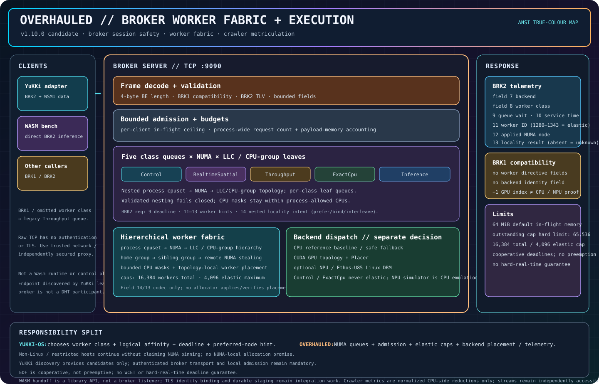

# Overhauled v1.11.1

> **Published v1.11.1:** release-metadata and documentation maintenance update. The previous v1.11.0 release added fixed-memory pairwise multivariate stream statistics for normalized numeric observations.

> **Route workloads by topology, not guesswork.**
>
> Turn GPU interconnect awareness into higher throughput, better tail latency, and more effective use of accelerator infrastructure.

> **Release status:** v1.11.1 is the latest published GitHub Release (2026-11-27). No binary assets are attached; use the GitHub source archive or clone the tag. This does not imply publication to an external package registry.

Overhauled is a C++17 placement and execution library with an interoperable broker service. It provides topology-aware GPU scheduling and broker dispatch for CPU, GPU, and optional NPU execution.

[](https://opensource.org/licenses/MIT)
[](#)
[](https://github.com/rakshas-oss/overhauled/releases/tag/v1.11.1)
[](#)

## What's new in v1.10.0 (published 2026-11-26)

- **Constant-memory crawler metrics:** add the standalone C++17 `Overhauled::crawler_metrics` library with public header `crawler_metrics.h`. It accepts normalized `PageObservation` values and accumulates page success/failure counts, bytes, links, fetch/extraction duration statistics, and bounded histogram percentile upper bounds.
- **Shard-friendly aggregation:** keep one unsynchronized fixed-memory accumulator per worker/NUMA shard and merge at a barrier. Counter overflow and self-merge are rejected without partial mutation.
- **YuKKi-OS crawler pairing:** designed to consume normalized records emitted by the YuKKi-OS v6.21 crawler. Integration is caller-driven; no raw HTML enters Overhauled and no BRK operation is added.
- **CPU-only semantics:** the metrics library is a deterministic CPU reduction component. It does not add GPU/NPU crawler dispatch, execute crawler network requests, or imply measured crawler throughput.

See [Crawler metric aggregation](docs/CRAWLER_METRICS.md) for the observation contract, examples and limitations.

## What's new in v1.11.1 (published 2026-11-27)

- **Version metadata synchronization:** advance the CMake project, Conan recipe and root vcpkg manifest together to 1.11.1.
- **Scope:** release metadata and documentation only. No runtime implementation, public API, dependency set, or BRK1/BRK2/WSM1/NXR1/MED1 wire behavior changes are included.
- **Package boundary:** the vcpkg registry port and Homebrew formula remain pinned to the separately verified 1.6.0 source archive. No external registry, Conan remote or Homebrew publication is implied.

## What's new in v1.11.0 (published 2026-11-26)

- **Bounded multivariate stream statistics:** add the standalone C++17 Overhauled::multivariate_stats library for online pairwise covariance and Pearson correlation over up to 32 normalized dimensions.
- **Missing-data semantics:** pairwise deletion preserves missing dimensions instead of coercing them to zero. Each matrix cell has its own pairwise sample count, which consumers must inspect before interpreting covariance or correlation values.
- **Fixed-memory shard reduction:** keep one accumulator per worker or NUMA shard and merge at an application-controlled barrier; no shared hot lock or stream-length-proportional sample storage is required.
- **Transactional validation:** reject invalid dimensions, non-finite present values, invalid masks and counter/numerical overflow without partially mutating accumulator state.
- **CPU-only boundary:** this is a numeric aggregation library, not a network listener, document parser, broker operation or automatic YuKKi-OS adapter. It does not imply GPU/NPU execution or a measured performance gain.

See Multivariate stream aggregation (docs/MULTIVARIATE_STREAMS.md) for the exact data contract and tests.

## What's new in v1.9.0 (published 2026-11-26)

- **Bounded broker sessions:** cap accepted client sessions at 1,024 and expose `--max-clients`. The implementation remains one blocking I/O thread per admitted client; this is a hard thread ceiling, not an event-driven I/O pool.
- **Private broker listener:** add `--bind-address` and `--require-mtls-proxy`. Strict proxy mode rejects any non-loopback listener address so the plaintext broker socket cannot be exposed remotely behind the TLS terminator.
- **TLS 1.3 sidecar profile:** add stunnel client/server examples with client-certificate verification, server-chain and hostname verification, loopback forwarding and documented certificate-rotation boundaries. This is external TLS termination, not a native TLS listener.
- **Replay persistence:** allow `ReplayGuard` to append accepted nonces to a private journal, fsync each record before acknowledging success, and restore unexpired entries after a single-process restart. The journal is capped at 64 MiB and fails closed on malformed data or write/sync/capacity errors.
- **Cross-platform journal I/O:** use POSIX fsync/0600 permissions and Windows commit/file APIs where supported by the build target.

### Deployment boundary

The mTLS proxy protects the broker connection in transit, but its verified certificate identity is not yet propagated into signed artifact-sender authorization. Replay-nonce persistence does not persist staged module bytes, prepared sessions, active-release state or runtime activation. The existing thread-per-client model remains bounded but is not the planned fixed event-driven I/O pool.

## What's new in v1.8.0 (published)

- **Explicit BRK2 GPU preference:** an explicit `device_preference=gpu` bypasses only the automatic minimum-byte offload heuristic; GPU availability, forced-CPU mode and exact-CPU/verification policy remain authoritative. Broker responses continue to report the backend actually selected.

- **Authenticated receiver state machine:** verify deployment-sender signatures and artifact-publisher provenance using separate trust stores; bind issuer, subject, audience and key ID; enforce expiry, nonce/replay checks and digest validation.
- **Prepare, transfer and activation:** accept bounded sequential chunks, produce signed prepare decisions and activation receipts, and preserve the previous active release when validation or activation fails.
- **Runtime bridge:** when both ENABLE_WASM_RUNTIME and ENABLE_WASM_HANDOFF are enabled, the optional Wasmtime bridge compiles the staged module set and promotes the resulting release atomically through the configured runtime callbacks.
- **Admission and flood controls:** enforce concurrent-session, staged-byte, module/chunk, global/per-sender message-rate and ingress-byte limits with bounded sender accounting.
- **Untrusted streams remain available:** NXR1, MED1 and media/stream-relay data paths do not require a WASM publisher key. They remain subject to their own frame, size, connection, rate and backpressure limits.
- **Independent feature gates:** ENABLE_WASM_HANDOFF=ON enables the receiver API and requires OpenSSL Crypto; ENABLE_WASM_RUNTIME=ON remains a separate optional Wasmtime feature. Neither changes the default build.

**Deployment boundary:** the receiver is not yet wired into the ordinary BRK1/BRK2 TCP listener. A caller must provide an authenticated protected transport (mTLS 1.3 or equivalent), bind transport identity to the signed sender, and provide durable replay/staging where restart-safe guarantees are required. The current shared-Store Wasmtime embedding is not a multi-tenant sandbox, and this release candidate does not claim complete remote deployment through the broker listener.

## YuKKi-OS crawler metric integration

Overhauled provides two standalone CPU-side aggregation libraries: crawler_metrics for bounded page-report summaries and multivariate_stats for fixed-memory pairwise covariance/correlation over numeric observations. They are caller-driven libraries, not broker operations or automatic YuKKi-OS routes. See docs/CRAWLER_METRICS.md and docs/MULTIVARIATE_STREAMS.md.

## Package managers

The vcpkg port and Homebrew formula are maintained alongside the source. They
target the portable CPU-only build; optional CUDA/TensorRT and WASM handoff
features remain separately enabled. See
[package-manager installation and publication](docs/PACKAGING.md).

## Capabilities

- NVLink-aware topology detection, sticky home-GPU affinity, and queue-aware placement.
- Heuristic backend dispatch: forced/safety-sensitive work remains CPU-first; eligible NPU inference requires an available executor, and data-parallel GPU work must meet the configured offload threshold.
- Broker responses report the backend actually selected; a BRK2 device preference is a request, not proof of hardware execution.
- BRK1/v1 compatibility and BRK2/v2 TLV framing on the same TCP listener.
- A shared Rust/C++ protocol conformance corpus and CPU-only test suite.
- Opt-in mainline Linux DRM Ethos-U85 executor, with a documented Vela-generated `YU85BND1` bundle format.
- Optional CUDA/TensorRT GPU runtime features; deterministic CPU-only broker operation remains available.
- Isolated Control, RealtimeSpatial, Throughput, ExactCpu and Inference worker pools with bounded process-wide admission and in-flight memory budgets.
- Deadline-aware spatial queue ordering, dynamically sized Linux CPU masks, nested NUMA/CPU-group placement, and BRK2 queue/service/worker telemetry.
- Per-class, per-CPU-group queue locks isolate scheduler contention;
  realtime deadline insertion uses ordered leaf-queue entries, and worker CPU
  affinity is stable within the worker's validated CPU-group assignment.
- Worker queues are sharded by LLC/CPU group within each process-visible NUMA
  node. Workers prefer their home group, steal within the NUMA parent next, and
  cross NUMA domains only as a fallback.
- Topology validation enforces machine cpuset -> NUMA node -> CPU-group
  containment, sibling disjointness, and bounded depth/fanout. Dynamic CPU masks
  support CPU IDs beyond the legacy CPU_SETSIZE boundary.
- Large-host worker limits are 16,384 total (4,096 elastic); automatic sizing
  targets physical cores and is capped at 4,096 workers.

## v1.2.0 published feature baseline

The published v1.2.0 release added a broker-side worker fabric coordinated with
YuKKi-OS workload directives:

- Five worker classes: Control, RealtimeSpatial, Throughput, ExactCpu and
  Inference, each with an isolated queue and reserved worker pool.
- RealtimeSpatial requests use earliest-deadline-first ordering when an
  absolute deadline is present; equal deadlines retain admission order.
- Process-wide outstanding-request and in-flight-memory budgets remain held
  until execution completes, including after client disconnect.
- Linux topology discovery builds a bounded machine -> NUMA -> LLC/CPU-group
  tree from the process affinity mask and sysfs, validates every child cpuset
  against its parent, and uses dynamically sized worker affinity masks.
  Telemetry reports a NUMA node only when affinity was successfully applied.
- Optional BRK2 request fields 11–13 carry worker class, logical spatial
  affinity and preferred NUMA node. Optional response fields 8–12 report
  worker class, queue wait, service time, worker ID and applied NUMA node.
- The dataset benchmark can exercise class, affinity, NUMA and deadline
  behavior and report queue/service measurements.
- Per-class queues are sharded across eligible CPU groups inside NUMA nodes. Optional elastic
  workers use weighted RealtimeSpatial/Throughput/Inference service with
  process-wide per-class ceilings; Control and ExactCpu remain dedicated.

BRK1 remains on the legacy Throughput queue and preserves its backend
selection semantics. Existing BRK1/BRK2/WSM1 envelope identities and required
fields are unchanged. Deadlines are broker request bounds, not preemption or
hard real-time guarantees. See
[YuKKi-aware worker fabric](docs/YUKKI_WORKER_FABRIC.md).

## What's new in v1.4.0

The v1.4.0 candidate adds the BRK2 locality-placement codec shared with
YuKKi-OS:

- **Request field 14:** bounded nested-TLV decoding for locality intent with
  extension version, scope, mode, optional NUMA-node, payload-size, duplicate
  field and unknown-critical-field validation.
- **Response field 13:** encodes the placement outcome returned by an allocator.
  An absent result means unknown/not applied; it must never be interpreted as
  successful placement.
- **Old-peer behavior:** `prefer` is non-critical; `bind` and `interleave`
  require the critical bit and cannot be silently ignored by older peers.

This is protocol codec support only. The broker does not yet allocate,
apply or verify payload memory placement. It does not establish physical
NUMA locality for request buffers, WASM linear memory, datasets, accelerator
staging, GPU VRAM or NPU memory. The existing BRK1/BRK2/WSM1 envelope
identities remain unchanged.

See [architecture](docs/ARCHITECTURE.md) and the
[YuKKi-aware worker fabric](docs/YUKKI_WORKER_FABRIC.md).

## Throughput and energy-efficiency model

The documented four-GPU A100 benchmark at eight concurrent clients reports 87.3 ops/s for NVLink-aware placement versus 58.4 ops/s for blind round-robin placement—approximately **49.5% higher throughput** in that workload.

A conditional energy-per-operation estimate can be derived from those throughput figures: **if average total system power is equal in both runs**, the higher-throughput configuration would use approximately **33.1% less energy per completed operation** (1 − 58.4 / 87.3). This is a normalized model, not a measured power reduction or a guaranteed electricity-bill saving. The benchmark does not report wall power, GPU-board power, host power, workload duty cycle, or facility overhead. Actual OPEX depends on measured system power, operating hours, utilization, and the local electricity tariff.

For a deployment, estimate annual energy cost as:

`annual kWh = average system kW × operating hours`

`annual electricity cost = annual kWh × tariff per kWh`

Compare both schedulers on the same hardware and workload while recording wall power and completed work. See [docs/BENCHMARK_RESULTS.md](docs/BENCHMARK_RESULTS.md) for the benchmark context.

## Backend selection and operational boundaries

The broker selects a backend before GPU placement. Forced CPU and unverified
exact-precision, verification-sensitive, or cryptographic profiles remain on
CPU. NPU execution requires an inference profile, the service-side enable gate,
and an available concrete executor. `--npu-simulated` is CPU emulation for
conformance only; physical Ethos-U execution is an opt-in Linux DRM path with
a compatible Vela `YU85BND1` bundle. A BRK2 device preference requests a
backend; the response is the authoritative report of what actually ran.

The broker's wire preference is not a substitute for a task's real semantics.
CPU retry after accelerator failure is only safe for operations that are
idempotent and explicitly marked fallback-safe. Review
[Architecture](docs/ARCHITECTURE.md) before changing dispatch policy.

## Control-plane and WASM boundary

YuKKi-OS remains the control plane and the host for its WSM1 guest-execution
path; Overhauled owns broker execution, protocol dispatch and accelerator
placement. WSM1 carries host-prepared task data and module-version lifecycle
metadata. It does not upload executable Wasm modules, and it does not activate
the native Wasmtime API.

Separately, Overhauled provides an opt-in native Wasmtime C API composition
path through `ENABLE_WASM_RUNTIME=ON`. Applications using that API compile and
compose core-Wasm modules inside the Overhauled process. This is an independent
execution path, not an automatic YuKKi-OS handoff. Its CI-supported dependency
is Wasmtime C API v51.0.0 on Linux x86_64. The initial runtime shares one Store
and resource domain; it is not a complete multi-tenant sandbox. See [native
Wasmtime runtime composition](docs/WASM_RUNTIME_COMPOSITION.md), [WSM1
interoperability](docs/WASM_INTEROP.md), and the [YuKKi-OS composition
guide](https://github.com/rakshas-oss/YuKKi-OS/blob/main/docs/WASM_PROGRAM_COMPOSITION.md).

## Cross-repository multivariate benchmark bridge

There are two complementary benchmark entry points, with different scopes:

- YuKKi-OS's browser runner executes its local spatial module in Node's
  WebAssembly runtime. When broker mode is enabled, it additionally submits
  host-prepared numeric fixture records directly to this broker over BRK2.
- This repository's dataset broker runner reads the shared version-1 dataset
  manifest and measures native broker ingress, dispatch, worker/batch
  concurrency, response latency, and actual backend telemetry.

Neither path sends executable Wasm modules to this broker. The browser
benchmark leg is ordinary BRK2 inference traffic, not a WSM1 guest task or
lifecycle operation. YuKKi-OS remains authoritative for manifest semantics,
spatial processing, resolver-derived locality hints, and the eigensolver.
Overhauled owns broker dispatch, worker-class queues, process-local Linux
NUMA discovery/CPU affinity, GPU topology/placement, and CPU/GPU/NPU execution.
The two repositories therefore keep workload-level topology semantics
separate from broker-local worker placement.

See [Dataset-driven BRK2 broker benchmarks](docs/DATASET_BROKER_BENCHMARK.md),
[YuKKi-OS benchmarking guide](https://github.com/rakshas-oss/YuKKi-OS/blob/main/docs/BENCHMARKING.md),
and [YuKKi-OS interoperability](docs/YUKKI_INTEROP.md).


## Architecture map — full-colour ANSI palette



Overhauled is the broker and execution tier. It validates BRK1/BRK2 frames,
applies bounded admission, routes requests into five isolated worker-class
queues with nested CPU-group/NUMA shards, performs broker-local Linux
CPU-group/NUMA affinity where supported, and uses hierarchical work stealing
(home group -> sibling groups -> remote NUMA) with bounded class-aware elasticity
before dispatching eligible work to CPU/GPU/NPU backends. It does not duplicate
YuKKi-OS workload semantics or spatial resolution: YuKKi selects the class
and sends an optional affinity key, deadline and preferred-NUMA hint;
Overhauled resolves that hint against its own process-allowed CPU topology and
reports the NUMA node only if thread affinity succeeds. BRK2 field 7 reports
the actual backend; optional fields 8–12 report worker and placement telemetry.
WSM1 remains task/lifecycle metadata, not a Wasm runtime; Wasmtime compilation,
guest isolation and execution remain on the YuKKi-OS host.

The accompanying terminal sketch uses 24-bit ANSI colours:
`bash docs/diagrams/print-ansi.sh`. GitHub does not render terminal escape
sequences inside Markdown code blocks, so the README embeds the equivalent
full-colour SVG.


## Quick start: CPU-only broker

```bash
git clone https://github.com/rakshas-oss/overhauled.git
cd overhauled
cmake -S . -B build \
  -DCMAKE_BUILD_TYPE=Release \
  -DENABLE_CUDA=OFF \
  -DENABLE_TENSORRT=OFF \
  -DBUILD_BROKER=ON
cmake --build build -j"$(nproc)"
ctest --test-dir build --output-on-failure
./build/broker_server 9090 --cpu-only
```

This mode is useful for CI, development, and non-GPU hosts. The service uses bounded broker framing, but the protocol is not an authentication layer; deploy it only on a trusted network or behind an authenticated transport.

## Optional Ethos-U85 Linux DRM backend

Physical NPU execution is opt-in and requires Linux with a kernel exposing the mainline Ethos-U DRM UAPI, plus a compatible Vela-generated bundle. Configure and build with:

```bash
cmake -S . -B build -DENABLE_ETHOSU_DRM=ON -DENABLE_CUDA=OFF -DENABLE_TENSORRT=OFF -DBUILD_BROKER=ON
cmake --build build -j"$(nproc)"
ctest --test-dir build --output-on-failure
```

Then launch using a `YU85BND1` model bundle:

```bash
./build/broker_server 9090 --npu-ethosu-bundle model.yu85
./build/broker_server 9090 --npu-ethosu-bundle model.yu85 --ethosu-device /dev/dri/renderD128
```

`--npu-simulated` is CPU emulation for CI/conformance, not hardware acceleration. See [docs/ETHOSU_U85_BUNDLE.md](docs/ETHOSU_U85_BUNDLE.md).

## Other build modes

```bash
# CUDA-aware placement, without TensorRT
cmake -S . -B build -DENABLE_CUDA=ON -DENABLE_TENSORRT=OFF

# TensorRT runtime server (requires CUDA and user-provided TensorRT)
cmake -S . -B build -DENABLE_CUDA=ON -DENABLE_TENSORRT=ON -DTENSORRT_ROOT=/path/to/tensorrt
```

## Security hardening

Placement validates non-empty GPU topology, model registry access is synchronized, and the optional TensorRT runtime enforces bounded framed input handling. The BRK2 response encoder caps error text to configured limits. These checks do not provide transport authentication. Review [docs/SECURITY_HARDENING_NOTES.md](docs/SECURITY_HARDENING_NOTES.md) and deploy network services behind an authenticated transport boundary.

## Documentation

- [Broker protocol](docs/BROKER_PROTOCOL.md) · [BRK2 conformance](docs/BRK2_CONFORMANCE_V1.md) · [BRK2 locality placement v1](docs/BRK2_LOCALITY_PLACEMENT_V1.md) · [Executable BRK corpus](docs/BRK_CONFORMANCE_V1.md)
- [YuKKi-OS interoperability](docs/YUKKI_INTEROP.md) · [WASM interoperability](docs/WASM_INTEROP.md)
- [Ethos-U85 bundle and hardware boundary](docs/ETHOSU_U85_BUNDLE.md) · [YuKKi-aware worker fabric](docs/YUKKI_WORKER_FABRIC.md)
- [Architecture and runtime decision model](docs/ARCHITECTURE.md) · [Library guide](docs/LIBRARY.md) · [Versioning](docs/VERSIONING.md)
- [Heuristic and backend-selection verification](docs/SYSADMIN_HOWTO.md)
- [System administration step-by-step](docs/SYSADMIN_HOWTO.md) · [Operations runbook](OPERATIONS_RUNBOOK.md) · [Deployment guide](DEPLOYMENT_GUIDE.md)
- [Publishing](docs/PUBLISHING.md) · [Release notes](docs/RELEASE_NOTES.md) · [Benchmarks](docs/BENCHMARK_RESULTS.md) · [Dataset-driven BRK2 workloads](docs/DATASET_BROKER_BENCHMARK.md)
- [Security hardening notes](docs/SECURITY_HARDENING_NOTES.md)

## License

MIT License — see [LICENSE](LICENSE). Optional CUDA Toolkit and TensorRT components are user-supplied proprietary NVIDIA software, not redistributed under this project's license; see [NOTICE](NOTICE).


## YuKKi-OS service discovery

YuKKi-OS can advertise reachable Overhauled broker endpoints through its authenticated peer mesh using bounded lease-based gossip. This does not make the broker a direct DHT participant; BRK1/BRK2 transport remains independently secured. See [YUKKI_BROKER_DISCOVERY.md](docs/YUKKI_BROKER_DISCOVERY.md).
