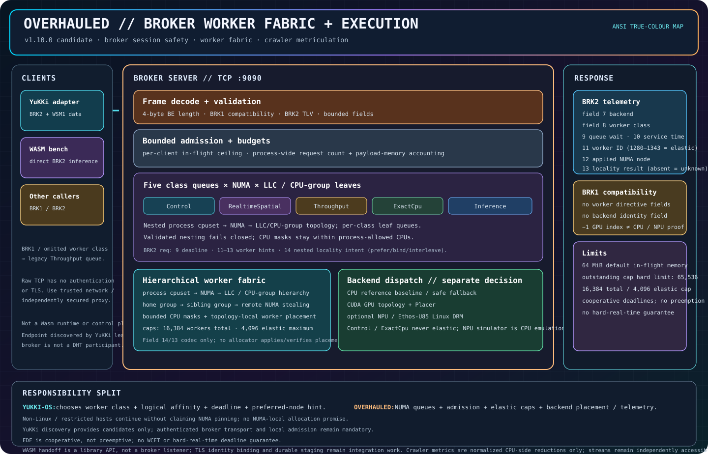

# Architecture and Runtime Decision Model

## 1. System boundary

Overhauled is the broker execution plane. It accepts bounded binary broker frames, validates optional YuKKi worker directives, admits requests into nested CPU-group/NUMA worker-class queue shards, applies process-cpuset-bounded CPU-group affinity where supported, optionally borrows bounded elastic worker capacity for eligible classes, selects an execution backend, and returns structured results and telemetry. YuKKi-OS owns workload semantics, class selection, spatial resolution, logical affinity keys, deadlines, and advisory preferred-NUMA hints; Overhauled owns local queue shards, dedicated and elastic worker admission, Linux process-allowed CPU discovery/worker affinity, GPU topology, accelerator placement, and execution. This repository does not embed YuKKi-OS. It can optionally link the Wasmtime C API when the native runtime feature is enabled; that runtime remains an independent broker-side component.

```text
YuKKi-OS / external client
        |
        | secured network or authenticated TCP proxy
        | raw TCP byte stream; no HTTP translation
        v
BrokerServer (default TCP port 9090)
        |
        +-- frame decoder and protocol limits
        |      +-- BRK1 / v1
        |      +-- BRK2 / v2 TLV
        |
        +-- kind-specific handlers
        |      +-- geospatial.frame.v1 (NXR1 validation / echo)
        |      +-- media.stream.v1 (MED1 validation / echo)
        |      +-- WASM task and lifecycle operations
        |
        +-- hierarchical worker scheduler (machine → NUMA → LLC/CPU group)
        |      +-- per-class ordered leaf queues and dedicated worker pools
        |      +-- home group → sibling group → remote NUMA work stealing
        |      +-- bounded elastic workers (RealtimeSpatial / Throughput / Inference)
        |      +-- validated process cpuset → NUMA → CPU-group nesting
        |
        +-- backend dispatcher (CPU / GPU / NPU)
               +-- CPU reference compute path
               +-- GPU compute path -> GpuTopology -> Placer
               +-- optional NPU executor
                       +-- simulated CPU executor (test only)
                       +-- optional Ethos-U85 Linux DRM executor
```

The broker is not an authentication, encryption, HTTP, or general-purpose model-serving layer. Put it on a trusted private network or behind an authenticated transport boundary.

### Full-colour system map



A terminal-renderable ANSI-colour version is available with
`bash docs/diagrams/print-ansi.sh`. The map shows five worker classes, nested CPU-group/NUMA queue shards,
dedicated workers, optional bounded elastic capacity, request/memory admission
budget, deadline ordering and broker-local Linux worker affinity. Preferred
NUMA routing narrows the eligible leaf set; logical affinity and round-robin
select within that set. Workers steal from their home group, sibling CPU groups,
then remote NUMA domains. Elastic capacity is limited to RealtimeSpatial,
Throughput and Inference; Control and ExactCpu remain dedicated. BRK2 fields 11–13 carry optional class and locality intent;
response fields 8–12 report worker and successfully applied CPU-affinity telemetry. Request field 14 carries the versioned nested locality-placement intent; response field 13 carries an allocator-reported placement result when one is produced. Codec support is present, but no broker-owned payload allocator applies the intent yet. BRK1 retains its legacy Throughput behavior and has no backend-identity field.
The NPU simulator is CPU emulation, not acceleration.


## Authenticated WASM deployment boundary
The explicit artifact-deployment path is separate from the normal broker listener:

```text
YuKKi-OS HandoffSender
        |
        | caller-provided HandoffTransport
        | mutually authenticated TLS 1.3 / equivalent
        v
Overhauled HandoffReceiver API
        |  sender + publisher trust, replay, size/rate admission
        |  sequential chunks + SHA-256 verification
        v
WasmHandoffRuntimeBridge (optional)
        |  compile full release in a fresh runtime/store
        v
atomic process-local active-runtime promotion
```

The diagram is a library/API integration path, not a new BRK1/BRK2, HTTP or WSM1 endpoint. The transport adapter must decode the shared schema into the receiver's typed request structures and bind its authenticated peer identity to the signed sender. A local successful activation is not a distributed transaction.

The optional `ENABLE_WASM_HANDOFF` component provides the Overhauled-side
prepare/transfer/activation API. It verifies signed deployment messages,
publisher provenance, replay state, bounded artifact chunks and module
digests; signs prepare decisions and activation receipts; and delegates
compile-only validation and atomic runtime promotion to configured callbacks.
It is not wired into the ordinary BRK1/BRK2 listener yet. Network integrations
must authenticate the peer (mTLS 1.3 or equivalent) and bind its identity to
the signed sender before calling the API. The optional ReplayGuard journal can persist consumed nonces across a single-process restart. Prepared staging bytes, active receipts and runtime state remain process-local; the journal is not shared safely across multiple broker processes.

Handoff admission is bounded by concurrent sessions, total staged bytes,
module and chunk sizes, global/per-sender message rate, global/per-sender
byte rate and a bounded sender bucket table. The callback must copy/own
verified module bytes before returning and must not change active state when
activation fails. See [WASM_HANDOFF_RECEIVER_IMPLEMENTATION.md](WASM_HANDOFF_RECEIVER_IMPLEMENTATION.md).

When both `ENABLE_WASM_RUNTIME` and `ENABLE_WASM_HANDOFF` are enabled,
`WasmHandoffRuntimeBridge` connects receiver admission to the local Wasmtime
C API. It builds a fresh runtime/store per staged release and atomically
publishes it after the complete module set compiles and registers. The broker
does not yet route every WSM1 task through this bridge; callers must obtain the
active runtime and select/invoke the appropriate module. This is not a
multi-tenant isolation boundary.

The executable-artifact trust policy does not apply to streaming. NXR1,
MED1 and existing stream-relay paths remain usable with untrusted sources
under their independent framing, byte, connection, rate and backpressure
limits. No WASM publisher key is required to ingest or consume a stream.

## 2. Transport and protocol boundary

Every TCP message is framed by a four-byte unsigned big-endian body length. The body magic selects BRK1/v1 or BRK2/v2; the same listener accepts both. The client chooses the format by sending its magic. There is no JSON HELLO negotiation.

- **BRK1/v1** is the compatibility path. It carries the established request contract but no backend-profile metadata. Without an operator-configured GPU default, profile-less BRK1 work uses CPU.
- **BRK2/v2** uses a bounded TLV envelope and request ID correlation. Its optional `device_preference` can request `cpu`, `gpu`, or `npu`; the response reports the backend actually selected. A request preference is not proof that hardware exists or that a hardware backend ran.
- Unknown critical fields, malformed encodings, duplicate singular fields, invalid lengths, and configured-limit violations are rejected.
- The protocol does not supply authentication, encryption, HTTP semantics, remote cancellation, or a negotiation handshake.

The full byte-level contract and limits live in [BROKER_PROTOCOL.md](BROKER_PROTOCOL.md), with cross-language vectors in [BRK_CONFORMANCE_V1.md](BRK_CONFORMANCE_V1.md) and [BRK2_CONFORMANCE_V1.md](BRK2_CONFORMANCE_V1.md).

## 3. Request classification and backend selection

Backend selection runs before GPU placement. The dispatcher is implemented in `include/backend_dispatch.h` and consumed by `BrokerService`.

The effective decision order is:

1. **Explicit CPU / forced CPU:** `--cpu-only` overrides all backend metadata. BRK2 `device_preference=cpu` also forces CPU for that request.
2. **Safety constraints:** exact-precision, verification-sensitive, or cryptographic profiles stay on CPU unless the profile explicitly declares an accelerator path verified.
3. **NPU-eligible inference:** inference work can use NPU only when NPU execution is enabled and a concrete executor reports available.
4. **GPU-eligible data-parallel work:** automatic GPU selection requires an available GPU and data-parallel classification. The default byte threshold is 1 MiB; an optional FLOP threshold is available to in-process callers. An explicit BRK2 `device_preference=gpu` bypasses only that size heuristic and requests GPU execution when available.
5. **CPU baseline:** requests that do not meet a selection rule run on CPU.

BRK2 `device_preference=gpu|npu` supplies a profile when the wire request has no in-process profile. An explicit GPU preference bypasses the automatic size threshold, but it still requires GPU availability and does not override forced-CPU or exact-CPU policy. NPU preference still requires an enabled, available executor. If the requested accelerator is unavailable, the dispatcher uses CPU rather than claiming that accelerator execution occurred. The CLI accepts `--default-backend npu`, but the current profile-less default-selection rule only auto-offloads to GPU; use BRK2 `device_preference=npu` (or an in-process inference profile) to request NPU work.

Accelerator failure is retried on CPU only when the request is declared `fallback_safe`. Otherwise the broker returns an execution error. Do not mark a non-idempotent or side-effecting operation fallback-safe unless repeating it on CPU is genuinely safe.

## 4. GPU topology and placement

GPU placement is a second-stage decision and runs only after GPU backend selection.

- `GpuTopology` detects the available CUDA-visible GPUs and their peer-link relationships.
- `Placer` assigns a stable home GPU for a client source and uses queue-depth feedback to decide whether to retain that GPU, move to a preferred peer, or choose the least-loaded available GPU.
- The default backlog threshold is 32.
- Per-GPU in-flight accounting bounds admission. The broker tracks payload-weighted in-flight work for placement decisions while separately enforcing request-count limits.
- With no usable GPU topology, work stays on CPU; a selected GPU index of `-1` is the expected CPU result.

NVLink is an optimization, not a prerequisite. Actual topology and placement depend on the host, CUDA runtime, driver, device visibility, and workload. Do not treat a benchmark topology or bandwidth figure as a property of every deployment.

## 5. Execution backends

### CPU

The CPU path is the deterministic baseline and the fallback path. The default compute example consumes a packed array of IEEE-754 binary64 values encoded big-endian and returns the same representation after the reference operation. Other request kinds have their own payload contracts; see the protocol guide.

### GPU

The optional CUDA-aware path detects GPU topology and uses the ADI compute entry point plus `Placer`. Configure with `-DENABLE_CUDA=ON`. CMake probes for a CUDA compiler and toolkit; if unavailable it reports a CPU-only build rather than silently claiming GPU support. TensorRT is a separate optional runtime target and requires CUDA plus user-provided TensorRT libraries.

### NPU

NPU execution is opt-in and requires a concrete executor:

- `--npu-simulated` installs a CPU-emulated executor for conformance and CI. It is not hardware acceleration and must not be used as evidence of NPU performance.
- The optional `ENABLE_ETHOSU_DRM=ON` build compiles the Linux mainline DRM Ethos-U executor. At runtime, `--npu-ethosu-bundle FILE` supplies a Vela-generated `YU85BND1` bundle. An optional `--ethosu-device /dev/dri/renderD*` pins the device; otherwise discovery uses `ETHOSU_DRM_DEVICE` and then writable render nodes.
- The real executor requires a compatible kernel exposing the Ethos-U DRM UAPI, a supported device, permissions to open its render node, and a bundle compiled for that target. Build success and simulator tests do not establish physical-board qualification.
- `--npu-enabled` only enables the service-side gate; by itself it does not create an executor. Prefer the explicit simulator or bundle options when configuring an NPU path.

See [ETHOSU_U85_BUNDLE.md](ETHOSU_U85_BUNDLE.md) for the bundle contract.

## 6. Dedicated payload handlers

The broker routes certain `kind` values before the default numeric compute path:

- `geospatial.frame.v1`: validates an NXR1 frame, including finite numeric values and bounded payload length, then echoes the validated frame.
- `media.stream.v1`: validates a MED1 video/audio/generic-data chunk and echoes an acknowledgement payload. This is transport validation, not media transcoding or inference.
- WASM task and lifecycle kinds are handled by the WASM sandbox integration compiled into `broker_service`.

These paths are separate contracts. A client must not send an NXR1 or MED1 payload as if it were a packed-double inference payload. See [WASM_INTEROP.md](WASM_INTEROP.md) and the relevant protocol sections.

### WASM task and lifecycle boundary

The WSM1 integration is a broker protocol and version-lifecycle manager, **not the YuKKi-OS guest runtime**. YuKKi-OS owns bytecode validation, Wasmtime compilation, guest instantiation, linear-memory limits and host imports for the WSM1 host-mediated path. Overhauled does not receive or compile a guest module during `Prepare`. Separately, Overhauled exposes an opt-in native Wasmtime composition API (`ENABLE_WASM_RUNTIME=ON`) for applications that explicitly compile and compose core-Wasm modules inside the broker process. This native path is independent of WSM1, is not an automatic handoff from YuKKi-OS, and is tested against Wasmtime C API v51.0.0 on Linux x86_64. See [WASM_RUNTIME_COMPOSITION.md](WASM_RUNTIME_COMPOSITION.md).

The C++ `WasmSandboxManager::prepare_module` records the sandbox/module/version identity, state, lease and optional GPU assignment. It does not parse `.wasm` bytes or retain a compiled artifact. `handle_task` checks the registered version and in-flight state, then calls an application-supplied `ComputeFn` when provided; otherwise it uses the broker's reference numeric compute path for packed binary64 payloads or echoes other payloads. The task payload is work input, not executable Wasm code.

The manager tracks active tasks, rejects work for draining/stopped versions, and refuses release while tasks remain in flight. For the WSM1 path, guest compilation, linking, instantiation and program composition remain on the YuKKi-OS host. WSM1 lifecycle operations do not merge multiple Wasm modules or policy functions into a compiled artifact. The separate native `WasmCompositionRuntime` API is described in [WASM_RUNTIME_COMPOSITION.md](WASM_RUNTIME_COMPOSITION.md) and is not invoked by these lifecycle operations.

TensorRT is a separate optional `gpu_runtime_server` target; it is not an automatic execution engine behind every WSM1 task. The Ethos-U85 path is also opt-in and accepts its documented Vela bundle contract. See [WASM_INTEROP.md](WASM_INTEROP.md) for the wire boundary and [SYSADMIN_HOWTO.md](SYSADMIN_HOWTO.md) for deployment configuration.

## 7. Concurrency, limits, and lifecycle

The server uses per-client sessions and five isolated worker classes. The scheduler decomposes the broker process's allowed CPU set into a validated machine → NUMA → LLC/CPU-group hierarchy, then creates per-class ordered leaf queues and dedicated worker pools. Workers prefer their home group, then sibling CPU groups, then remote NUMA domains; Linux affinity is best-effort and remains bounded by the process cpuset. Optional elastic workers are topology-local and serve RealtimeSpatial, Throughput and Inference only; Control and ExactCpu remain dedicated. The configured worker budget is capped at 16,384 total threads, including at most 4,096 elastic workers. Queue memory remains protected by process-wide outstanding-request and in-flight-memory budgets. Defaults are 128 clients, 32 in-flight requests per client, 4,096 derived process-wide outstanding requests, 64 MiB in-flight request memory, and a 5-second socket timeout.

The listener defaults to all IPv4 interfaces (`0.0.0.0`) for compatibility. Set `--bind-address 127.0.0.1` when placing an mTLS terminator such as stunnel in front of it; the terminator can then forward decrypted traffic only to the loopback broker socket. Do not expose the plaintext broker port. Restrict any non-loopback listener with firewall rules or a private network. Shutdown closes the listener and active client sockets and drains/stops worker activity according to the server lifecycle.

The broker has stdout/stderr startup and shutdown diagnostics. It does not currently expose a built-in HTTP health endpoint or metrics endpoint; monitoring must be supplied by the process supervisor, host telemetry, or the authenticated proxy layer.

### Cross-repository discovery, memory locality, and deterministic execution

YuKKi-OS is the control-plane discovery authority for this broker. Its current BrokerServiceRecord is relayed through the authenticated bootstrap/gossip mesh with bounded leases and hop counts. Overhauled is an advertised service, not a direct DHT participant. The present registry is not Kademlia, is not persistent across bootstrap restarts, and does not authorize execution. The broker listener remains raw BRK1/BRK2 TCP; deployments must protect it with a private trusted network or an independently authenticated mTLS proxy. Service capability labels are discovery hints, not proof of hardware availability. See YuKKi-OS [broker service discovery](https://github.com/rakshas-oss/YuKKi-OS/blob/main/docs/BROKER_SERVICE_DISCOVERY.md).

The current locality path is deliberately split. YuKKi-OS selects workload intent, logical affinity, deadline and an advisory preferred NUMA node. Overhauled validates its own process-allowed CPU topology, routes to a local CPU-group queue, attempts worker-thread affinity, and reports the applied NUMA node only when the pin succeeds. BRK2 now defines a versioned, bounded locality-placement codec: request field 14 carries nested intent (`prefer`, `bind`, or `interleave`) with scope, optional NUMA node, and payload-size ceiling; response field 13 carries an explicit allocator-reported outcome. `prefer` remains non-critical for old-peer compatibility, while `bind` and `interleave` require the critical bit. This is codec support only: Overhauled does not yet apply the intent to broker-owned payload allocations, and no allocator verification path currently emits a successful placement result. An absent response result means unknown/not applied, never success. The extension does not place Wasm linear memory, datasets, accelerator staging buffers, GPU VRAM, or NPU memory. YuKKi-OS owns policy; the process that owns each allocation must apply and verify it. Never let a remote hint widen the broker cpuset or bypass local memory quotas.

RealtimeSpatial uses isolated worker capacity and cooperative EDF ordering within a leaf queue. Running tasks are not preempted by this queue policy, and there is no WCET, interrupt-latency, or deadline-completion guarantee. Hard real-time claims require a separately qualified OS/hardware profile with CPU and IRQ isolation, locked/preallocated memory, bounded allocation and syscall paths, priority-inversion controls, admission/WCET budgets, and worst-case jitter validation. Until that qualification exists, describe the path as deadline-aware / soft-real-time, not hard real-time.

## 8. Build-time feature matrix

| CMake option | Default | Effect |
|---|---:|---|
| `BUILD_BROKER` | ON | Builds broker service and `broker_server` |
| `ENABLE_CUDA` | ON | Probes CUDA compiler/toolkit; falls back to CPU-only if unavailable |
| `ENABLE_TENSORRT` | OFF | Builds `gpu_runtime_server`; requires CUDA and TensorRT |
| `ENABLE_ETHOSU_DRM` | OFF | Compiles the Linux Ethos-U DRM executor; Linux only |
| `ENABLE_WASM_RUNTIME` | OFF | Embeds the optional native Wasmtime C API composition runtime; requires `BUILD_BROKER=ON` and a Wasmtime C API installation (CI pins v51.0.0) |
| `ENABLE_INTEROP_ENCRYPTION` | OFF | Requests an optional source file that must exist in the checkout; verify availability before enabling |
| `BUILD_EXAMPLES` | ON | Builds example binaries |

CPU-only broker builds should explicitly set `-DENABLE_CUDA=OFF -DENABLE_TENSORRT=OFF -DBUILD_BROKER=ON`. Optional hardware backends should be enabled only after their toolchains, runtime libraries, kernel interfaces, and devices are installed.

## 9. Heuristic tuning and validation

Tune one decision boundary at a time, using the benchmark harness and representative payloads:

1. Establish a CPU-only correctness baseline.
2. Confirm backend selection from the response, not merely from the requested preference.
3. Compare GPU placement with the same workload, hardware, concurrency, and warm-up policy.
4. Sweep the GPU byte threshold and backlog threshold; record throughput, p50/p95/p99 latency, queue depth, GPU utilization, and transfer topology.
5. Measure wall power if making energy claims. Throughput-only results cannot establish power or OPEX savings.
6. Exercise accelerator failure with both fallback-safe and fallback-unsafe profiles.
7. Keep protocol conformance and adversarial tests enabled while tuning.

The benchmark values in [BENCHMARK_RESULTS.md](BENCHMARK_RESULTS.md) are workload-specific observations, not universal guarantees. Do not copy a threshold from one GPU topology or dataset into production without rerunning the workload.

## Heuristic values and interpretation

The dispatcher uses explicit task metadata rather than treating a requested
device as proof of hardware execution:

- Forced CPU ("--cpu-only" or BRK2 device_preference=cpu) wins first.
- Exact-precision, verification-sensitive and cryptographic profiles remain
  on CPU unless the profile explicitly marks an accelerator path verified.
- NPU is selected for inference profiles only when the NPU gate is enabled and
  the configured executor reports available. --npu-enabled alone is only
  the gate; --npu-simulated installs CPU emulation, while
  ENABLE_ETHOSU_DRM=ON plus a compatible YU85BND1 bundle enables the
  optional physical Linux path.
- GPU is selected for data-parallel profiles when the GPU is available and
  the configured byte threshold (default 1 MiB) or non-zero FLOP threshold is
  met. A zero FLOP threshold disables that criterion.
- Without a task profile, only an operator-configured GPU default can
  auto-offload; a profile-less --default-backend npu request still resolves
  to CPU. A BRK2 device_preference=npu supplies an inference profile, but
  the response's selected backend remains authoritative.

The dispatcher and service implementation have different sources of profile
metadata: in-process callers supply TaskProfile, while the BRK2 adapter maps
wire-level device_preference to a basic profile when no in-process profile
exists. That wire preference path marks the generic numeric request as
fallback-safe; application-specific, side-effecting operations should not be
declared fallback-safe unless CPU re-execution is actually idempotent.

GPU placement is a second stage after GPU backend selection. The current
topology detector converts CUDA peer performance-rank/native-atomic signals
into relative link hints (100/90 for preferred peer links and 10 for PCIe).
Those values are ordinal heuristic scores, not measured GB/s, latency, or
a portable physical bandwidth guarantee. Re-profile on each target system.

For the full operational sequence, use [System administration](SYSADMIN_HOWTO.md).

## 10. Source-of-truth implementation map

| Concern | Implementation |
|---|---|
| Build features and target graph | `CMakeLists.txt` |
| BRK1/BRK2 framing and schemas | `src/broker_protocol.cpp`, `src/brk2_protocol.cpp`, corresponding headers |
| TCP listener, sessions, limits | `src/broker_server.cpp`, `include/broker_server.h` |
| Class worker pools, leaf queues and hierarchical stealing | `src/worker_scheduler.cpp`, `include/worker_scheduler.h` |
| Bounded CPU topology discovery, cpuset validation and dynamic affinity masks | `src/worker_topology.cpp`, `include/worker_topology.h` |
| CLI and runtime backend wiring | `src/broker_server_main.cpp` |
| Backend policy and NPU interface | `include/backend_dispatch.h`, `include/npu_device.h` |
| Broker routing and execution | `src/broker_service.cpp`, `include/broker_service.h` |
| GPU topology and placement | `src/nvlink_placement.cpp`, `include/nvlink_placement.h` |
| Ethos-U DRM execution | `src/ethosu_u85_drm_executor.cpp`, `include/ethosu_u85_drm_executor.h` |
| NXR1 and MED1 handlers | `src/geospatial_frame.cpp`, `src/media_stream.cpp` |
| WASM sandbox | `src/wasm_sandbox.cpp`, `include/wasm_sandbox.h` |

## YuKKi-directed worker fabric

Overhauled maintains five worker classes with an ordered queue on each
eligible CPU-group leaf beneath a process-visible NUMA parent. Dedicated
workers are pinned to a home CPU group. When local work is unavailable, they
steal from sibling groups in the same NUMA node, then remote NUMA nodes.
Optional elastic workers follow the same locality order and are capped at
4,096; the combined dedicated-plus-elastic process limit is 16,384. Elastic
service remains restricted to RealtimeSpatial, Throughput and Inference,
subject to process-wide concurrent ceilings per class. Control and ExactCpu
never use elastic capacity.

RealtimeSpatial retains earliest-deadline-first order within each leaf queue;
other classes preserve FIFO order within a leaf. Preferred-NUMA hints are
honoured only when an eligible leaf exists under that node; otherwise routing
uses the logical affinity key or round-robin. Linux topology discovery uses
dynamic CPU masks and validates strict machine-cpuset -> NUMA -> CPU-group
containment, sibling disjointness and exact child coverage. No request hint can
widen the process CPU set. This is placement isolation, not multi-tenant
identity isolation: mutually untrusted tenants require separate broker
processes/containers with disjoint cgroup cpusets and memory limits.

The process-wide outstanding-request and in-flight-memory budget remains the
queue admission bound and reservations remain held through completion. The
feature adds no BRK2 fields and does not change BRK1 behavior. See
[YUKKI_WORKER_FABRIC.md](YUKKI_WORKER_FABRIC.md) for CLI settings, limits,
security boundaries and operational validation.
