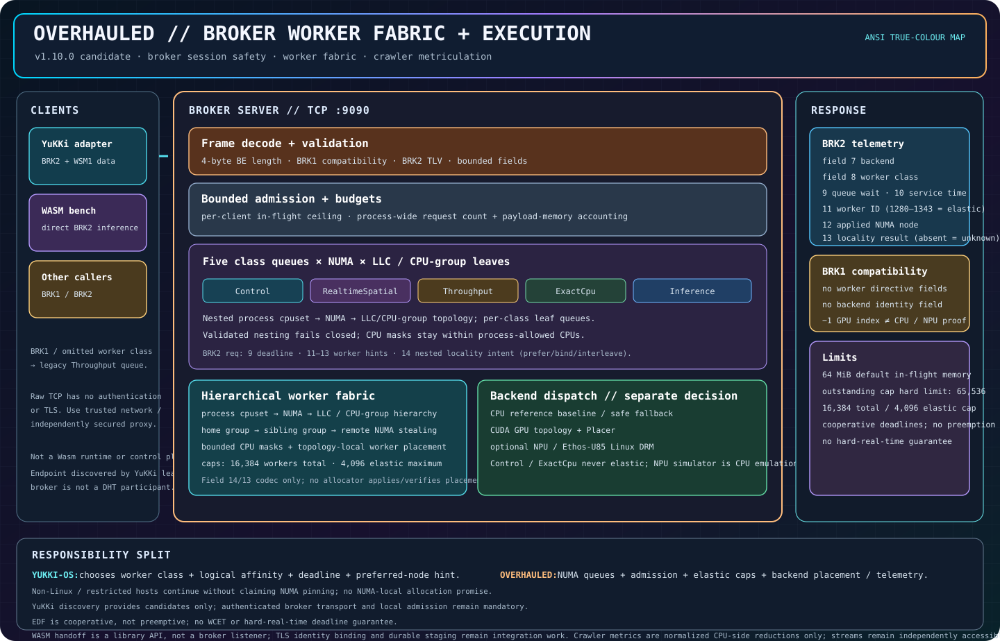

# YuKKi-OS-Aware Worker Fabric

This document describes the broker-side execution contract for YuKKi-OS-directed
work. YuKKi-OS owns workload meaning and emits an optional BRK2 directive.
Overhauled owns bounded admission, local class queues, Linux CPU/NUMA affinity,
accelerator dispatch, and execution telemetry.

The repositories remain separate. This feature does not move Wasmtime,
NXR1 interpretation, spatial freshness policy, or numerical semantics into
Overhauled.



The diagram summarizes the five isolated queues, their ordering rules,
process-wide admission controls, broker-local Linux NUMA affinity, backend
dispatch and BRK2 response telemetry. It is paired with the terminal renderer
at `docs/diagrams/print-ansi.sh`.

## Worker classes

BRK2 request TLVs extend the existing request schema without changing the
BRK2 envelope version or the BRK1/BRK2/WSM1 protocol identities.

| Class | Intended work | Local execution policy |
|---|---|---|
| `control` | Protocol and lifecycle coordination | Dedicated worker pool; CPU execution |
| `realtime-spatial` | Time-sensitive spatial streams | Dedicated pool; earliest-deadline-first when a deadline is supplied, otherwise FIFO; logical affinity and optional NUMA hint |
| `throughput` | Dataset, batch, and parallel workloads | Dedicated pool; normal local backend policy |
| `exact-cpu` | Exactness, verification, and crypto-sensitive workloads | Dedicated pool; CPU forced |
| `inference` | Model inference | Dedicated pool; local NPU/GPU policy applies |

An explicit class is workload intent, not an unconditional hardware command.
Overhauled validates the directive and retains final authority over local
capacity and backend availability. A device preference refines the class but
cannot override the CPU-only policy of `control` or `exact-cpu`.

BRK1 clients and BRK2 clients that omit field 11 retain the legacy
`throughput` scheduling default, but the legacy request is not treated as an
explicit Throughput backend profile. This preserves existing BRK1 backend
selection semantics.

## BRK2 request and response fields

Optional request fields:

| Field | Wire type | Meaning |
|---:|---|---|
| 11 | UTF-8 | `control`, `realtime-spatial`, `throughput`, `exact-cpu`, or `inference` |
| 12 | U64 | Stable logical spatial-affinity key |
| 13 | U32 | Preferred NUMA node ID |

A `realtime-spatial` directive must include field 12. Field 13 is advisory:
the broker only reports a NUMA node when it successfully applies CPU affinity
within the process's allowed CPU mask.

Existing response field 7 continues to report the selected backend. Additional
optional response fields are:

| Field | Wire type | Meaning |
|---:|---|---|
| 8 | UTF-8 | Worker class actually dispatched |
| 9 | U64 | Queue wait in microseconds |
| 10 | U64 | Service time in microseconds |
| 11 | U32 | Broker worker ID |
| 12 | U32 | NUMA node successfully applied, when available |

Responses rejected before dispatch omit worker telemetry. Older clients can
ignore optional response fields; older brokers can ignore optional non-critical
request fields. The WSM1 payload is unchanged.

## Queue ordering, capacity, and overload protection

Each class has its own dynamically growing queue and reserved worker pool.
Control, Throughput, ExactCpu, and Inference preserve FIFO admission order.
RealtimeSpatial is FIFO when no deadline is supplied; requests with an
absolute deadline are inserted earliest-deadline-first, with equal deadlines
preserving admission order and deadline-bearing tasks preceding tasks with no
deadline. There is no cross-class global ordering. Class isolation is
intentional: a throughput backlog cannot occupy the reserved control or
real-time workers.

The queues have no fixed per-class entry limit. They allocate on demand, but
the broker still applies a process-wide admission budget to prevent memory
exhaustion:

- At most 65,536 outstanding requests process-wide.
- By default, the request count is derived from
  `max_clients * max_inflight_per_client`, capped at 65,536. Defaults are
  128 clients and 32 in-flight requests per client (4,096 outstanding).
- The default in-flight memory budget is 64 MiB. Accounting includes request
  payload bytes, bounded routing strings, and fixed request metadata.
- Each admitted request holds its count and memory reservation until execution
  completes, including after the client socket disconnects.
- Exhausted budgets and allocation failures reject admission safely. They do
  not terminate a worker thread or bypass the limit after reconnect.

Configure limits with `--max-outstanding N` (zero derives the default) and
`--max-inflight-bytes N`. Do not raise them without measuring resident memory
under worst-case payload sizes and concurrent clients.

The per-client in-flight cap remains active. Global admission accounting also
closes the disconnect/reconnect loophole: queued work retains its reservation
until its completion guard runs.

## NUMA placement

On Linux, the worker fabric reads node CPU lists from
`/sys/devices/system/node/node*/cpulist`, intersects them with the process's
current `sched_getaffinity` mask, and applies worker-thread affinity with
`pthread_setaffinity_np`.

A requested NUMA node is used when it exists in the process-allowed topology.
Otherwise the broker falls back to a node selected from the logical affinity
key or worker identity. CPU selection rotates within the selected node to
avoid every worker pinning itself to the first CPU. The response reports the
node only when affinity application succeeds.

On non-Linux systems, restricted containers, or hosts where affinity cannot
be applied, worker execution continues without claiming NUMA pinning. A
logical spatial key is not a physical CPU ID, geographic coordinate, or
promise of hard real-time execution.

## Deadlines and timeouts

The broker computes a monotonic deadline at admission from the smaller of the
relative request timeout and the optional absolute BRK2 Unix-nanosecond
deadline. The RealtimeSpatial queue uses that converted monotonic deadline for
within-class earliest-deadline-first admission. If the task expires while queued, it returns Timeout without
starting execution. The remaining deadline budget is passed into the broker
service, and a result completed after the deadline is not returned as success.

This is a cooperative request deadline around broker execution. It cannot
preempt an already-running GPU kernel or guarantee that arbitrary native code
will stop at an exact wall-clock instant.

## Worker sizing

Defaults reserve one worker each for Control, RealtimeSpatial, ExactCpu, and
Inference. Remaining workers go to Throughput. With automatic sizing, the
total target is `min(256, max(5, 2 * hardware_concurrency))`.

Example:

```bash
./build/broker_server 9090 \
  --workers-control 1 \
  --workers-realtime 2 \
  --workers-throughput 8 \
  --workers-exact-cpu 1 \
  --workers-inference 2 \
  --max-outstanding 4096 \
  --max-inflight-bytes 67108864
```

The combined worker count must be 1..256. Every dedicated class pool must
have at least one worker. If `--workers-throughput` is omitted, the legacy
`--workers TOTAL` or automatic total determines the throughput remainder.

## Operational measurements

BRK2 response telemetry supplies queue wait, service time, worker class,
worker ID, and applied NUMA node. Use those values with client-side p50/p95/p99
latencies, backend counts, rejected admissions, and resident memory.

Benchmark representative YuKKi-OS drone, finance, and environmental datasets
through the live BRK2 broker. Include mixed-class concurrency, class
saturation, client disconnect/reconnect churn, oversized payloads, deadlines
that expire while queued, and CPU fallback. A microbenchmark that bypasses
the broker worker pools does not validate this execution fabric.

## Compatibility and ownership

- BRK1, BRK2, and WSM1 envelope identities are unchanged.
- New BRK2 request metadata is optional and non-critical.
- BRK1 requests continue on the legacy Throughput queue and existing backend
  semantics.
- YuKKi-OS chooses the class and logical workload hints.
- Overhauled validates and applies local admission, NUMA placement, and
  accelerator policy.
- NXR1 payload bytes are opaque to this scheduling layer.
